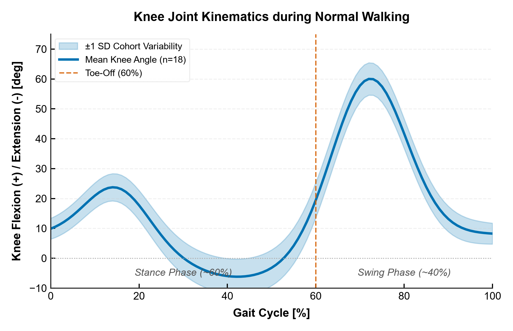
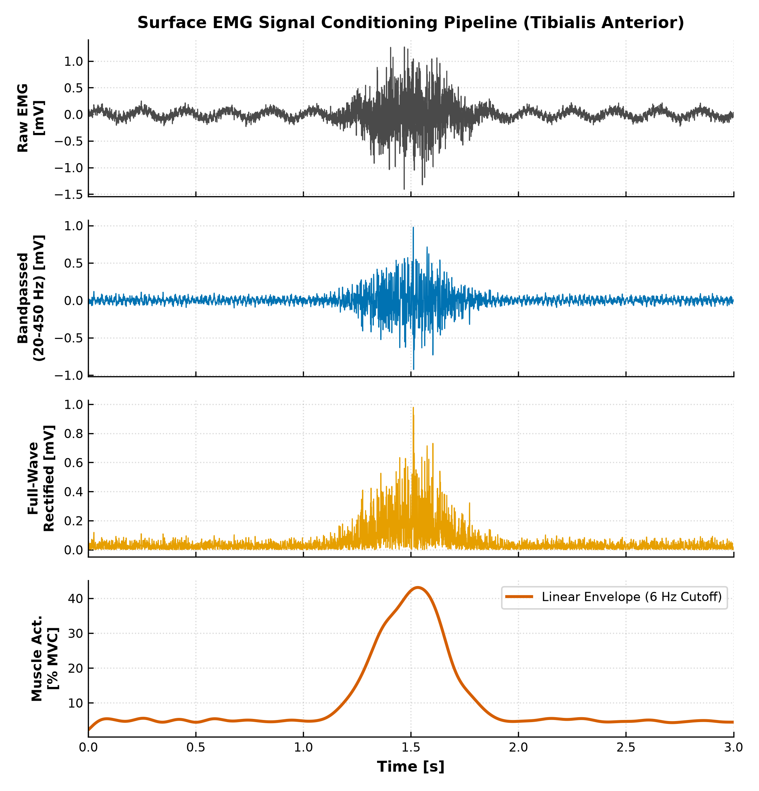
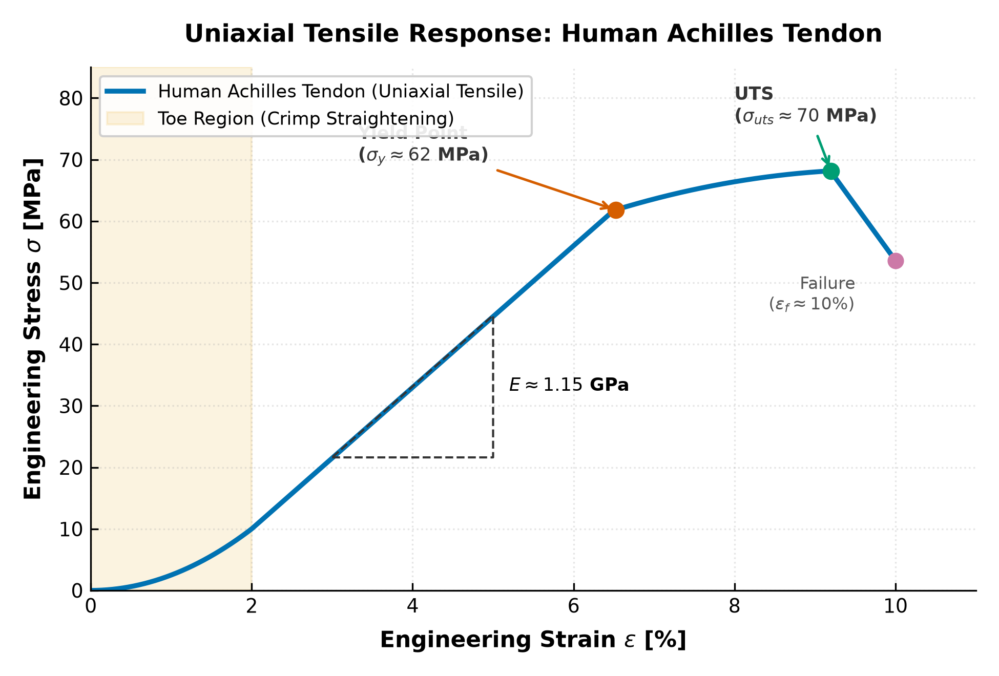
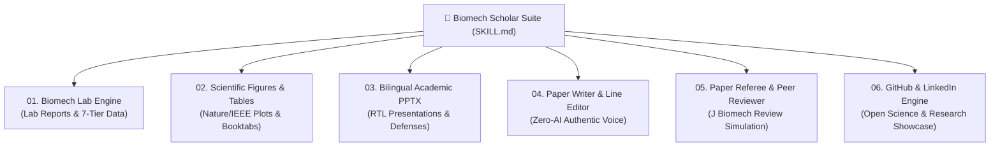

<div align="center">

# 🦾 Biomech Scholar Suite
### The Complete Bilingual Research, Laboratory, and Presentation Operating System for Biomechanics
### مجموعه جامع مهندسی، پژوهشی، آزمایشگاهی و دانشگاهی بیومکانیک

[](https://www.python.org/)
[](https://opensource.org/licenses/MIT)
[](https://github.com/psf/black)
[](https://www.journals.elsevier.com/journal-of-biomechanics)
[](https://github.com/amirhacn/biomech-scholar-suite)

[**فارسی (Persian Documentation)**](README_FA.md) | [**English Documentation**](README.md) | [**Agent SKILL.md**](SKILL.md)

</div>

---

## 🌟 Overview

**Biomech Scholar Suite** is an all-in-one, production-grade agentic skill suite engineered specifically for **Biomechanical Engineering students, researchers, and lab directors**. 

It eliminates the fragmentation between raw motion analysis tools, report writing, publication plotting, conference slide design, paper authoring, peer review, and academic dissemination. Every component is natively **bilingual (Persian and English)**, enforces **zero hallucination**, eliminates robotic AI clichés (such as `می‌باشد` or `delve into`), and strictly complies with the highest international standards (*Journal of Biomechanics*, *IEEE Transactions on Biomedical Engineering*, *Gait & Posture*, APA 7th, and IEEE).

---

## 📊 Publication Figures & Visualization Gallery

<div align="center">

| Knee Joint Kinematics (Mean ± SD) | sEMG Conditioning Pipeline |
|:---:|:---:|
|  |  |
| *Time-normalized 0–100% gait cycle with shaded ±1 SD band* | *Raw EMG to normalized % MVC linear envelope* |

<br/>

| Tissue Viscoelastic Stress-Strain Response |
|:---:|
|  |
| *Human tendon uniaxial tensile test: Toe region, Young's modulus (E), yield point, and UTS* |

</div>

---

## 🏛 Architecture & The 6 Core Modules



### 1. `01_biomech_lab_engine` — Laboratory Reports & Data Categorizer
- **Lab Report Builder:** Comprehensive 10-section formal laboratory report templates in Persian (`lab_report_template_fa.md`) and English (`lab_report_template_en.md`).
- **7-Tier Directory Architecture:** Automatically structures experimental projects (`01_raw_data/`, `02_processed_data/`, `03_scripts/`, `04_figures/`, `05_lab_reports/`, `06_presentations/`, `07_manuscripts/`).
- **Domain Guides:** Detailed experimental rubrics for 3D Motion Capture (Vicon/Qualisys/C3D), Force Plates (GRF & CoP), Surface EMG (SENIAM guidelines, filtering & MVC normalization), Tissue Tensile Testing, and Finite Element Analysis (FEA).
- **Uncertainty Analysis:** Mathematical quantification of calibration residuals, Soft Tissue Artifacts (STA), and inertial parameter approximations.

### 2. `02_scientific_figures_tables` — Scientific Plotting & Publication Tables
- **Executable Python Scripts:**
  - `plot_gait_cycle.py`: Time-normalized gait cycle kinematics (0–100%) with shaded $\pm 1$ SD cohort ribbons, toe-off indicator line, and despine borders.
  - `plot_emg_processing.py`: Multi-panel surface EMG conditioning pipeline (raw $\rightarrow$ 20–450 Hz bandpass $\rightarrow$ full-wave rectification $\rightarrow$ 6 Hz low-pass linear envelope $\rightarrow$ % MVC normalization).
  - `plot_stress_strain.py`: Tissue biomechanics tensile curve displaying toe region uncrimping, Young's modulus ($E$), yield point, ultimate tensile strength (UTS), and strain energy density.
  - `table_formatter.py`: Automated APA 7th and IEEE 3-rule booktabs formatter (top, middle, and bottom horizontal rules, zero vertical lines) exporting to Markdown, LaTeX, and Word DOCX.
- **Colorblind-Friendly Palettes:** Built-in Okabe-Ito color standard.

### 3. `03_bilingual_academic_pptx` — Conference & Defense Presentation Engine
- **3 Presentation Archetypes:** 10-minute conference talk (10 slides), 40-minute master/PhD thesis defense (35 slides), and lab meeting progress report.
- **python-pptx RTL Engine:** Overcomes PowerPoint's lack of native RTL support through DrawingML XML manipulation (`rtl="1"`, Complex Script `a:cs` font bindings to *Vazirmatn*, mirrored column layout, and custom Persian bullet counters).
- **High Visual Density:** Enforces the "one core claim per slide" principle and eliminates boring walls of bullet points.

### 4. `04_bilingual_paper_writer_editor` — Academic Writer, Editor & Humanizer
- **Zero-AI Persian Voice ("مثل خودم بنویسه"):** Eliminates all 18 classic AI tells (`می‌باشد`, `به شمار می‌رود`, `نقش بسزایی دارد`, `از اهمیت ویژه‌ای برخوردار است`, `در دنیای امروز`, `لازم به ذکر است`, `گاهاً`, `—`, etc.).
- **Strict Orthography & Mechanics:** Fully compliant with Persian Academy standards, zero-width non-joiner (ZWNJ / نیم‌فاصله) rules, Persian digits in running text, and elimination of the *Haksare* error (`ه` vs. ezafe).
- **English Nature/IEEE Register:** Eliminates corporate filler (`delve into`, `shed light on`, `pivotal role`, `testament`), purges verb nominalizations, and calibrates scientific hedging.
- **Factual Fidelity:** Enforces zero-hallucination rules—never shifts statistical uncertainty, rounds empirical percentages, or invents citations.

### 5. `05_bilingual_paper_referee` — Journal Referee & Peer Review Simulator
- **Top Venue Simulation:** Rigorous evaluation mimicking *Journal of Biomechanics*, *IEEE Transactions on Biomedical Engineering*, and *Gait & Posture*.
- **5-Pillar Evaluation Matrix:** Originality & gap analysis, biomechanical modeling validity, signal processing cutoff frequency consistency, statistical power & effect size, and limitation discussion.
- **Formal Review Reports:** Structured reports featuring an Executive Summary, Key Strengths, Major Revisions, Minor Line-by-Line Comments, and Recommendation (Accept / Minor / Major / Reject).

### 6. `06_github_and_linkedin_engine` — Open Science & Research Dissemination
- **GitHub Repository Packaging:** Production README template, dynamic badges, MIT License, and machine-readable `CITATION.cff` for automated academic citations.
- **Authentic LinkedIn Showcases:** 4-stage post architecture (Hook, Technical Context, Quantitative Proof, Call to Action) eliminating corporate cringe ("Excited to announce!") in both Persian and English.

---

## 🚀 Quick Start & CLI Tools

### 1. Initialize Standard Biomechanics Workspace
```bash
python scripts/biomech_data_organizer.py --dir "." --name "Gait_Analysis_Project"
```

### 2. Clean Persian Text & ZWNJ (نیم‌فاصله)
```bash
python scripts/persian_orthography_cleaner.py --in "my_report.md" --out "my_report_clean.md"
```

### 3. Lint Persian Writing for AI Tells & Haksare
```bash
python scripts/fa_academic_linter.py "my_report_clean.md"
```

### 4. Generate Publication Plots
```bash
# Gait Cycle Kinematics
python modules/02_scientific_figures_tables/scripts/plot_gait_cycle.py --out "04_figures/knee_kinematics.png"

# sEMG Conditioning Pipeline
python modules/02_scientific_figures_tables/scripts/plot_emg_processing.py --out "04_figures/emg_pipeline.png"

# Tissue Stress-Strain Tensile Curve
python modules/02_scientific_figures_tables/scripts/plot_stress_strain.py --out "04_figures/tissue_tensile.png"
```

### 5. Verify & Repair RTL in Word (.docx) Files
```bash
python scripts/verify_docx_pptx_rtl.py "my_manuscript.docx" --fix --font "Vazirmatn"
```

---

## 📦 Installation & Dependencies

Clone the repository and install dependencies:

```bash
git clone https://github.com/amirhacn/biomech-scholar-suite.git
cd biomech-scholar-suite
pip install -r requirements.txt
```

Recommended Persian font: **Vazirmatn** (SIL Open Font License) available from Google Fonts or [rastikerdar/vazirmatn](https://github.com/rastikerdar/vazirmatn).

---

## 📜 Citation

If you utilize this suite or its modules in your academic publications or laboratory projects, please cite:

```bibtex
@software{khalouzadeh2026biomech_scholar_suite,
  author       = {Khalouzadeh, Amirhassan},
  title        = {Biomech Scholar Suite: The Complete Bilingual Research, Laboratory, and Presentation Operating System for Biomechanics},
  year         = {2026},
  publisher    = {GitHub / Zenodo},
  url          = {https://github.com/amirhacn/biomech-scholar-suite}
}
```

---

## 📄 License
Distributed under the **MIT License**. See `LICENSE` for details.
