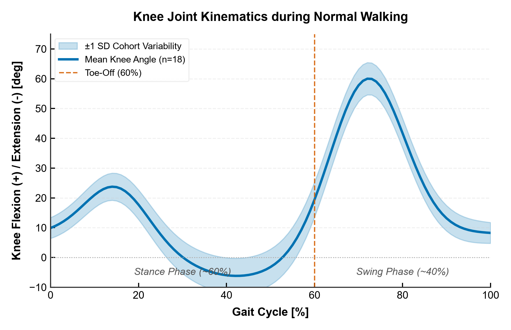
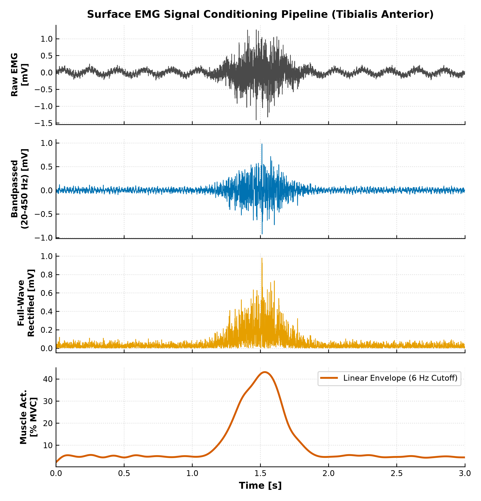
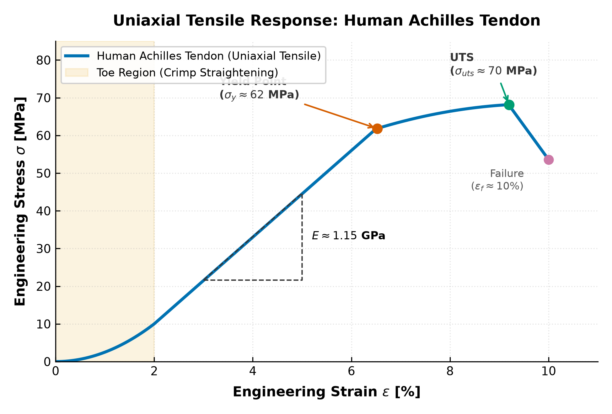
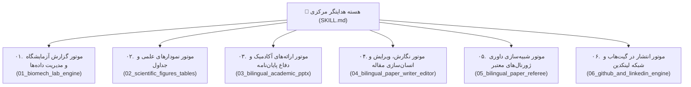

<div align="center">

# 🦾 مجموعه جامع پژوهشی و آکادمیک بیومکانیک (Biomech Scholar Suite)
### سیستم عامل هوشمند و یکپارچه برای نگارش، آزمایشگاه، ارائه و انتشار علمی دانشجویان و پژوهشگران مهندسی بیومکانیک

[](https://www.python.org/)
[](https://opensource.org/licenses/MIT)
[](https://www.journals.elsevier.com/journal-of-biomechanics)
[](README_FA.md)

[**مستندات فارسی**](README_FA.md) | [**English Documentation**](README.md) | [**فایل هسته اسکیل (SKILL.md)**](SKILL.md)

</div>

---

## 📖 معرفی و فلسفه وجودی

دانشجویان و پژوهشگران مهندسی بیومکانیک در فرآیند پژوهش دانشگاهی با چالش‌های متعددی روبرو هستند: از ثبت و پردازش داده‌های حرکتی چندگانه (C3D، صفحات نیرو و الکترومایوگرافی)، تا نگارش گزارش‌های فنی آزمایشگاه، رسم نمودارهای برداری آماده چاپ، تدوین اسلایدهای دفاع پایان‌نامه و ارائه‌های کنفرانس با چیدمان راست‌به‌چپ (RTL)، نگارش و ویرایش مقالات علمی بدون ردپای هوش مصنوعی، داوری مقالات و نهایتاً انتشار نتایج در گیت‌هاب و لینکدین.

**Biomech Scholar Suite** این چرخه را به صورت یکپارچه، تخصصی و دوزبانه (فارسی و انگلیسی) سامان داده است. این پکیج با الهام از دقیق‌ترین شیوه‌نامه‌های نگارش دانشگاهی و معتبرترین ژورنال‌های حوزه بیومکانیک (*Journal of Biomechanics*، *IEEE TBME*، *Gait & Posture*) طراحی شده و استفاده از الگوهای زبانی کلیشه‌ای و افعال اداری هوش مصنوعی (مانند `می‌باشد`، `به شمار می‌رود`، `نقش بسزایی دارد`) را به طور کامل ریشه‌کن کرده است.

---

## 📊 گالری نمودارهای برداری و علمی آماده چاپ

<div align="center">

| سینماتیک مفصل زانو در چرخه گام (میانگین ± انحراف معیار) | خط لوله ۴ مرحله‌ای پردازش سیگنال الکترومایوگرافی سطحی |
|:---:|:---:|
|  |  |
| *چرخه گام‌برداری ۰ تا ۱۰۰٪ با نوار خطای انحراف معیار و نشانگر جدا شدن پنجه* | *تبدیل سیگنال خام به پوش خطی فیلترشده و نرمال‌شده با % MVC* |

<br/>

| رفتار مکانیکی تنش-کرنش بافت‌های کلاژنی (تاندون آشیل) |
|:---:|
|  |
| *آزمون کشش تک‌محوره: نمایش ناحیه انگشتی، مدول یانگ، تنش تسلیم و استحکام نهایی* |

</div>

---

## 🏛 ساختار ۶ ماژول تخصصی پکیج



### ۱. موتور گزارش آزمایشگاه و مدیریت داده‌ها (`01_biomech_lab_engine`)
- **قالب کامل ۱۰ بخشی گزارش آزمایشگاه:** نسخه‌های رسمی و آماده تکمیل به زبان فارسی (`lab_report_template_fa.md`) و انگلیسی (`lab_report_template_en.md`).
- **پوشه‌بندی ۷ لایه پروژه:** سامان‌دهی سیستماتیک داده‌های خام C3D، سیگنال‌های فیلترشده، اسکریپت‌ها، نمودارها، گزارش‌ها، ارائه‌ها و مقالات.
- **راهنمای تجربی ۵ حوزه اصلی:** پروتکل‌های تحلیل گیت، صفحات نیرو و محاسبه مرکز فشار (CoP)، الکترومایوگرافی سطحی (استاندارد SENIAM و نرمال‌سازی با MVC)، آزمون کشش بافت‌های زیستی (رفتار ویسکوالاستیک تاندون و استخوان) و مدل‌سازی اجزای محدود (FEA).
- **تحلیل خطا و عدم قطعیت:** فرمول‌بندی خطای کالیبراسیون و خطای جابه‌جایی بافت نرم (Soft Tissue Artifact).

### ۲. موتور تولید نمودارهای علمی و جداول (`02_scientific_figures_tables`)
- **اسکریپت‌های پایتون آماده اجرا:**
  - `plot_gait_cycle.py`: رسم چرخه گام‌برداری نرمال‌شده (۰ تا ۱۰۰٪) با نوار سایه‌زده میانگین $\pm$ انحراف معیار، خط‌چین جدا شدن پنجه (Toe-Off) و حذف خطوط کادر بالا و راست.
  - `plot_emg_processing.py`: خط لوله کامل ۴ مرحله‌ای پردازش sEMG (سیگنال خام $\rightarrow$ فیلتر میان‌گذر ۲۰ تا ۴۵۰ هرتز $\rightarrow$ یک‌سوسازی $\rightarrow$ پوش خطی با فیلتر ۶ هرتز $\rightarrow$ نرمال‌سازی با بیشینه انقباض ارادی % MVC).
  - `plot_stress_strain.py`: منحنی تنش-کرنش کشش تاندون با نمایش ناحیه انگشتی (Toe Region)، شیب مدول یانگ ($E$)، نقطه تسلیم، استحکام نهایی (UTS) و چقرمگی.
  - `table_formatter.py`: قالب‌بندی خودکار جداول ۳ خطی علمی (APA 7th و IEEE booktabs) بدون خطوط عمودی در فرمت‌های مارک‌داون، لاتکس و ورد.
- **رعایت دسترسی‌پذیری رنگ‌ها:** پالت رنگی استاندارد Okabe-Ito مناسب برای افراد مبتلا به کوررنگی و چاپ سیاه‌وسفید.

### ۳. موتور ارائه‌های آکادمیک و دفاع پایان‌نامه (`03_bilingual_academic_pptx`)
- **۳ آرکی‌تایپ استاندارد ارائه:** ارائه مقاله در کنفرانس (۱۰ دقیقه، ۱۰ اسلاید)، جلسه دفاع پایان‌نامه ارشد/دکتری (۴۰ دقیقه، ۳۵ اسلاید)، و جلسات هفتگی آزمایشگاه.
- **موتور راست‌به‌چپ با `python-pptx`:** حل بنیادین مشکلات پاورپوینت در زبان فارسی با تنظیمات لایه DrawingML XML (`rtl="1"`، فونت اسکریپت پیچیده `a:cs` برای وزیرمتن، چیدمان آیینه‌شده ستون‌ها و لیست‌های شماره‌دار فارسی).
- **چگالی دیداری بالا:** حاکمیت اصل «یک ادعای کلیدی در هر اسلاید» و پرهیز از دیوارهای متنی خسته‌کننده.

### ۴. موتور نگارش، ویرایش و انسان‌سازی مقاله (`04_bilingual_paper_writer_editor`)
- **لحن اصیل دانشگاهی فارسی («مثل خودم بنویسه»):** پاک‌سازی کامل ۱۸ نشانهٔ قالبی هوش مصنوعی (`می‌باشد`، `به شمار می‌رود`، `نقش بسزایی دارد`، `از اهمیت ویژه‌ای برخوردار است`، `در دنیای امروز`، `لازم به ذکر است`، `گاهاً`، خط تیره بلند `—` و...).
- **رعایت بی‌نقص رسم‌الخط:** تنظیم دقیق نیم‌فاصله‌ها (ZWNJ)، استفاده از ارقام فارسی در متن فارسی و رفع خطای هکسره (عدم استفاده از «ه» به جای کسره اضافه).
- **سبک مقاله‌نویسی انگلیسی نیچر و الزویر:** حذف حشوهای متنی (`delve into`، `pivotal role`، `testament`)، کنترل افعال مجهول در روش‌ها و معلوم در نتایج، و کالیبراسیون قیود قطعیت علمی.
- **وفاداری مطلق به داده‌ها:** ممنوعیت قطعی گرد کردن اعداد (۵۸٫۴٪ تبدیل به ۵۹٪ نمی‌شود)، حفظ حدود اطمینان و عدم جعل مراجع یا DOI.

### ۵. موتور شبیه‌سازی داوری ژورنال‌های معتبر (`05_bilingual_paper_referee`)
- **شبیه‌سازی داور ژورنال‌های تراز اول:** ارزیابی موشکافانه بر اساس معیارهای *Journal of Biomechanics*، *IEEE TBME* و *Gait & Posture*.
- **ماتریس ممیزی ۵ گانه:** اصالت ایده و شکاف پژوهش، صحت دینامیک معکوس، هماهنگی فرکانس قطع فیلترهای سینماتیک و سینتیک، توان آماری و اندازه اثر کوهن، و نقد محدودیت‌ها.
- **گزارش رسمی داوری:** شامل خلاصه اجرایی، نقاط قوت، ایرادات اساسی (Major Revisions)، ایرادات جزئی خط‌به‌خط (Minor Comments) و توصیه نهایی به سرسردبیر.

### ۶. موتور انتشار در گیت‌هاب و شبکه لینکدین (`06_github_and_linkedin_engine`)
- **بسته‌بندی استاندارد گیت‌هاب:** فایل `README.md` با نشان‌های پویا، مجوز نرم‌افزار MIT و فایل استناد استاندارد `CITATION.cff` برای استناددهی خودکار آکادمیک.
- **پست‌های جذاب و معتبر لینکدین:** فرمول ۴ بخشی (قلاب آغازین، زمینه فنی، شواهد عددی، فراخوان به عمل) با نثری موثق و بدون تعارفات یا کلیشه‌های مبتذل شبکه‌های اجتماعی («خوشحالم اعلام کنم!»).

---

## 🛠 ابزارهای خط فرمان و راهنمای سریع

### ۱. راه‌اندازی پوشه‌بندی استاندارد بیومکانیک
```bash
python scripts/biomech_data_organizer.py --dir "." --name "Gait_Project"
```

### ۲. پاک‌سازی خودکار رسم‌الخط و نیم‌فاصله‌های متن فارسی
```bash
python scripts/persian_orthography_cleaner.py --in "report.md" --out "report_clean.md"
```

### ۳. بررسی متن فارسی با لینتر آکادمیک (کشف نشانه‌های هوش مصنوعی و هکسره)
```bash
python scripts/fa_academic_linter.py "report_clean.md"
```

### ۴. رسم نمودارهای برداری آماده چاپ
```bash
# رسم چرخه گام‌برداری با نوارهای انحراف معیار
python modules/02_scientific_figures_tables/scripts/plot_gait_cycle.py --out "04_figures/gait_kinematics.png"

# خط لوله فیلترگذاری و پوش خطی الکترومایوگرافی سطحی (sEMG)
python modules/02_scientific_figures_tables/scripts/plot_emg_processing.py --out "04_figures/emg_processing.png"

# منحنی تنش-کرنش کشش تاندون با نواحی الاستیک و تسلیم
python modules/02_scientific_figures_tables/scripts/plot_stress_strain.py --out "04_figures/tendon_tensile.png"
```

### ۵. اعتبارسنجی و اصلاح چیدمان راست‌به‌چپ در فایل‌های Word
```bash
python scripts/verify_docx_pptx_rtl.py "my_manuscript.docx" --fix --font "Vazirmatn"
```

---

## 💻 نصب و پیش‌نیازها

برای استفاده از اسکریپت‌ها، مخزن را کلون کرده و وابستگی‌ها را نصب کنید:

```bash
git clone https://github.com/amirhacn/biomech-scholar-suite.git
cd biomech-scholar-suite
pip install -r requirements.txt
```

فونت پیشنهادی برای اسناد و نمودارهای فارسی، **وزیرمتن (Vazirmatn)** است که می‌توانید آن را از [گیت‌هاب صابر راستی‌کردار](https://github.com/rastikerdar/vazirmatn) یا Google Fonts دریافت نمایید.

---

## 📜 نحوه ارجاع علمی (Citation)

در صورت بهره‌گیری از این جعبه‌ابزار یا ماژول‌های آن در مقالات علمی، پایان‌نامه‌ها یا گزارش‌های آزمایشگاهی، لطفاً به صورت زیر ارجاع فرمایید:

```bibtex
@software{khalouzadeh2026biomech_scholar_suite,
  author       = {Khalouzadeh, Amirhassan},
  title        = {Biomech Scholar Suite: The Complete Bilingual Research, Laboratory, and Presentation Operating System for Biomechanics},
  year         = {2026},
  publisher    = {GitHub / Zenodo},
  url          = {https://github.com/amirhacn/biomech-scholar-suite}
}
```

---

## 📄 مجوز نرم‌افزار (License)
این پکیج تحت مجوز آزاد **MIT License** منتشر شده است و استفاده دانشگاهی و صنعتی از آن با ذکر منبع آزاد است.
