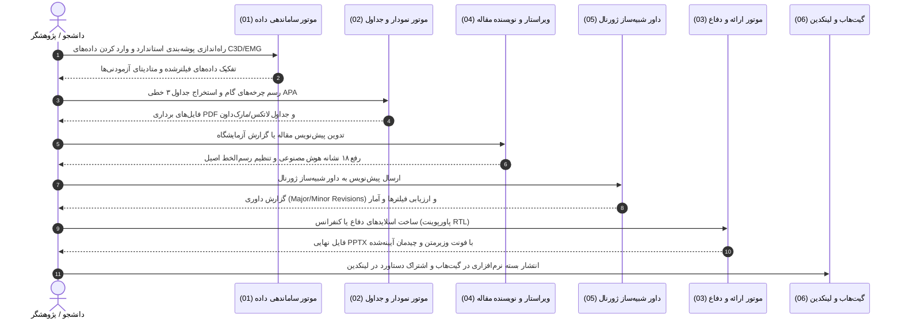

# Biomech Scholar Suite (مجموعه جامع مهندسی و آکادمیک بیومکانیک)
### The Complete Bilingual Research, Laboratory, and Presentation Operating System for Biomechanics

## ۱. نقشه راه و هدایت هوشمند وظایف (Task Router)

هنگامی که کاربر درخواستی در زمینه بیومکانیک، نگارش، آزمایشگاه، ارائه، یا تحلیل داده مطرح می‌کند، بر اساس جدول زیر به ماژول تخصصی هدایت شوید:

| نیاز یا درخواست کاربر | ماژول مسئول | ابزارها و اسکریپت‌های اجرایی | مستندات مرجع |
|---|:---:|---|---|
| **گزارش آزمایشگاه بیومکانیک، ساماندهی داده‌ها** | `01_biomech_lab_engine` | `scripts/biomech_data_organizer.py` | `modules/01_biomech_lab_engine/references/` |
| **رسم نمودارهای علمی، گیت، EMG، جداول APA/IEEE** | `02_scientific_figures_tables` | `plot_gait_cycle.py`, `plot_emg_processing.py`, `plot_stress_strain.py`, `table_formatter.py` | `modules/02_scientific_figures_tables/references/` |
| **ارائه کنفرانس، دفاع پایان‌نامه، اسلایدهای RTL** | `03_bilingual_academic_pptx` | `scripts/verify_docx_pptx_rtl.py` | `modules/03_bilingual_academic_pptx/references/` |
| **نگارش مقاله، ویرایش، حذف هوش مصنوعی (De-AI)** | `04_bilingual_paper_writer_editor` | `scripts/persian_orthography_cleaner.py`, `scripts/fa_academic_linter.py` | `modules/04_bilingual_paper_writer_editor/references/` |
| **داوری مقاله، شبیه‌سازی داور J Biomech / IEEE** | `05_bilingual_paper_referee` | چک‌لیست ماتریس داوری و خط‌کش ارزیابی | `modules/05_bilingual_paper_referee/references/` |
| **پروژه گیت‌هاب، فایل استناد، پست لینکدین** | `06_github_and_linkedin_engine` | تولید `CITATION.cff`, `README.md` و قالب‌های لینکدین | `modules/06_github_and_linkedin_engine/references/` |

---

## ۲. اصول تخطی‌ناپذیر اسکیل (The Ironclad Rules)

1. **طبیعی و مقتدر بودن لحن («مثل خودم بنویسه»):**
   - در زبان فارسی، استفاده از ۱۸ نشانهٔ قالبی هوش مصنوعی اکیداً ممنوع است:
     - ❌ `می‌باشد / نمی‌باشد` $\rightarrow$ ✅ `است / نیست` یا فعل دقیق جمله.
     - ❌ `گردید / می‌گردد` $\rightarrow$ ✅ `شد / می‌شود`.
     - ❌ `به شمار می‌رود / محسوب می‌شود` $\rightarrow$ ✅ `است / تلقی می‌شود`.
     - ❌ `لازم به ذکر است / شایان ذکر است` $\rightarrow$ ✅ حذف حشو و بیان مستقیم پیام.
     - ❌ `نقش بسزایی دارد / از اهمیت ویژه‌ای برخوردار است` $\rightarrow$ ✅ بیان تأثیر عددی مشخص.
     - ❌ `در دنیای امروز / در عصر تکنولوژی` $\rightarrow$ ✅ ورود بی‌واسطه به مسئله علمی.
     - ❌ خطای هکسره (نوشتن کسره اضافه با «ه» مانند «کتابه من» به جای «کتابِ من»).
2. **رعایت کامل رسم‌الخط و مکانیک زبان (Orthography & Mechanics):**
   - نیم‌فاصله (ZWNJ) با نویسه U+200C در تمام افعال استمراری (می‌شود)، جمع‌ها (مارکرها)، و صفات (بزرگ‌تر).
   - اعداد در متن فارسی با ارقام فارسی (۰۱۲۳۴۵۶۷۸۹) و ممیز فارسی (٫).
   - شروع هر سطر یا بالت فارسی با یک واژه فارسی (نه کلمه انگلیسی) برای جلوگیری از چپ‌چین شدن خودکار پاراگراف (Bidi Rule).
3. **وفاداری مطلق به داده‌ها (Zero Hallucination):**
   - هیچ عدد، درصد یا خطای اندازه‌گیری بدون پشتوانه نباید جعل شود.
   - هیچ رفرنس یا شناسه دیجیتالی (DOI) اختراع نمی‌شود.
4. **استاندارد نمودارها و جداول علمی:**
   - نمودارها با پالت رنگی Okabe-Ito، بدون کادر بالا و راست، با واحدهای SI در کروشه `[N·m/kg]`.
   - جداول بر اساس استاندارد ۳ خطی کتابچه‌ای (APA / IEEE booktabs) بدون هرگونه خط عمودی.

---

## ۳. دستورات سریع ترمینال (Terminal CLI Shortcuts)

```bash
# ۱. سامان‌دهی داده‌ها و ایجاد پوشه‌های ۷ لایه پروژه:
python scripts/biomech_data_organizer.py --name "Gait_Project"

# ۲. پاک‌سازی خودکار رسم‌الخط، نیم‌فاصله‌ها و گیومه‌ها:
python scripts/persian_orthography_cleaner.py --in "report.md" --out "report_clean.md"

# ۳. ارزیابی متن فارسی و کشف ردپای هوش مصنوعی و هکسره:
python scripts/fa_academic_linter.py "report_clean.md"

# ۴. رسم چرخه گام‌برداری آماده چاپ:
python modules/02_scientific_figures_tables/scripts/plot_gait_cycle.py --out "gait_plot.png"

# ۵. رسم مراحل پردازش الکترومایوگرافی سطحی (sEMG):
python modules/02_scientific_figures_tables/scripts/plot_emg_processing.py --out "emg_plot.png"

# ۶. رسم منحنی تنش-کرنش بافت‌های زیستی:
python modules/02_scientific_figures_tables/scripts/plot_stress_strain.py --out "tissue_plot.png"

# ۷. اعتبارسنجی چیدمان راست‌به‌چپ (RTL) در فایلهای Word:
python scripts/verify_docx_pptx_rtl.py "output.docx" --fix
```

---

## ۴. چرخه حیات یک پروژه تحقیقاتی بیومکانیک (The Research Lifecycle)


