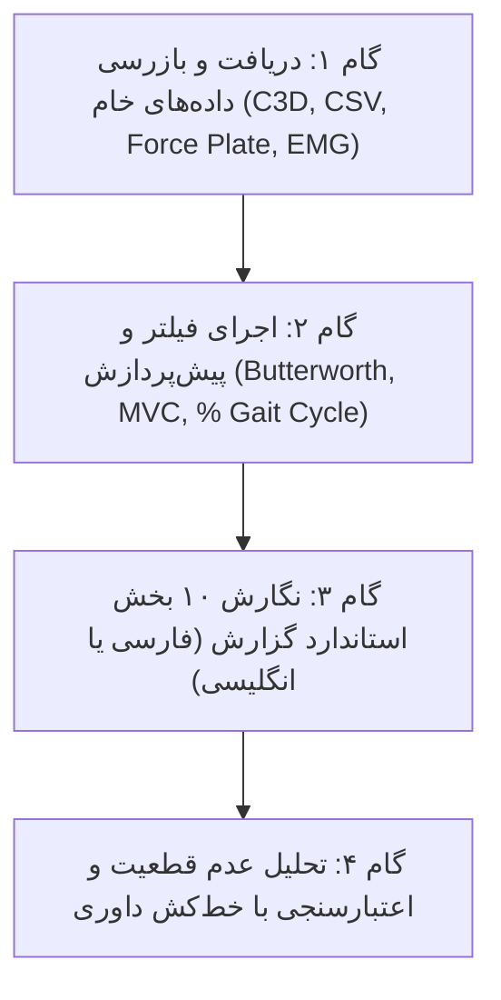

# Biomechanics Lab & Experimental Data Engine
# موتور گزارش‌نویسی آزمایشگاه و مدیریت داده‌های بیومکانیک

## مأموریت (Mission)
تولید گزارش‌های آزمایشگاهی دقیق، مستند و استاندارد مهندسی بیومکانیک به هر دو زبان فارسی و انگلیسی، همراه با تحلیل عدم قطعیت، دسته‌بندی سیستماتیک داده‌های خام (C3D, CSV, MAT, OpenSim) و پوشه‌بندی استاندارد پروژه‌های دانشگاهی.

## قواعد بنیادین آزمایشگاه (Non-Negotiable Laboratory Principles)
1. **جداسازی شواهد واقعی از اهداف ازپیش‌تعیین‌شده:** هرگز داده‌های آزمایشگاهی، نویزها یا خطاهای کالیبراسیون را مخفی نکنید. داده‌های پرت (Outliers) باید همراه با استدلال فیزیکی (مانند تکان ناگهانی مارکر یا نویز کابل EMG) گزارش شوند.
2. **تحلیل خطا و عدم قطعیت (Uncertainty Analysis):** هر اندازه‌گیری باید همراه با خطای ابزار (Resolution, Sampling Rate, Cutoff Frequency) و خطای نسبی/مطلق گزارش شود.
3. **گزارش دقیق واحدهای بین‌المللی (SI Units):**
   - زوایا: درجه $[deg]$ یا رادیان $[rad]$.
   - سرعت زاویه‌ای: $[deg/s]$ یا $[rad/s]$.
   - نیرو: نیوتن $[N]$ یا نرمال‌شده به وزن بدن $[BW]$ یا $[\% BW]$.
   - گشتاور مفصلی: $[N\cdot m]$ یا نرمال‌شده به جرم $[N\cdot m/kg]$.
   - توان مفصلی: $[W/kg]$.
   - تنش و کرنش: $[MPa]$ یا $[kPa]$ و کرنش $[\%]$ یا بی بعد $[\epsilon]$.
   - سیگنال الکترومایوگرافی: ولتاژ خام $[\mu V]$ یا $[mV]$ و نرمال‌شده $[\% MVC]$.
4. **رعایت شیوه‌نامه نگارش علمی:** در گزارش‌های فارسی هیچ‌یک از ۱۸ نشانهٔ هوش مصنوعی (مانند می‌باشد، از اهمیت ویژه‌ای برخوردار است، لازم به ذکر است) به کار نمی‌رود.

---

## گردش‌کار ۴ مرحله‌ای (4-Step Workflow)



### گام ۱: دسته‌بندی و پوشه‌بندی داده‌ها
قبل از شروع نگارش، فایل‌ها در ساختار ۷ لایه سامان‌دهی می‌شوند:
```bash
python scripts/biomech_data_organizer.py --name "Gait_Experiment_01"
```
داده‌های خام در `01_raw_data/`، کدهای متلب/پایتون در `03_scripts/` و نمودارهای برداری در `04_figures/` قرار می‌گیرند.

### گام ۲: پیش‌پردازش داده‌ها و ثبت متادیتا
- **سینماتیک (Kinematics):** فیلتر پایین‌گذر باترورث مرتبه ۴ بدون شیفت فاز (zero-lag) با فرکانس قطع ۶ هرتز (Winter residual analysis).
- **الکترومایوگرافی سطحی (sEMG):** فیلتر میان‌گذر ۲۰ تا ۴۵۰ هرتز، یک‌سوسازی تمام‌موج، پوش خطی با فیلتر پایین‌گذر ۶ هرتز و نرمال‌سازی با انقباض بیشینه ارادی (% MVC).
- **سینتیک (Kinetics):** فیلتر نیروی صفحه نیرو همگام با مارکرها (معمولاً ۱۰ تا ۵۰ هرتز) برای حذف نویزهای دینامیکی.

### گام ۳: تدوین ساختار ۱۰ بخشی گزارش آزمایشگاه
گزارش باید طبق فایل `references/lab_report_rubric_bilingual.md` دارای ۱۰ بخش کامل باشد:
1. مشخصات و عنوان آزمایش (Title & Metadata)
2. چکیده اجرایی (Executive Summary)
3. مقدمه و مبانی بیومکانیکی (Introduction & Biomechanical Theory)
4. مشخصات آزمودنی‌ها و تجهیزات (Subjects & Instrumentation)
5. پروتکل آزمایشگاهی و ایمنی (Experimental Protocol)
6. پردازش سیگنال و مدل‌سازی (Signal Processing & Modeling)
7. نتایج و تحلیل داده‌ها (Results & Data Presentation)
8. تحلیل خطا و عدم قطعیت (Error & Uncertainty Analysis)
9. بحث و مقایسه با ادبیات (Discussion & Physiological Interpretation)
10. پاسخ به سوالات آزمایشگاه و مراجع (Post-Lab Questions & References)

### گام ۴: ارزیابی با اسکریپت‌های پایتون
متن گزارش را با لینتر فارسی بررسی کنید:
```bash
python scripts/fa_academic_linter.py modules/01_biomech_lab_engine/templates/lab_report_template_fa.md
```
و نمودارهای رسمی آزمایشگاه را با اسکریپت‌های ماژول ۰۲ استخراج نمایید.
